# 🎹 Proyecto MIDI: Generación y Modelado Musical con MidiTok (REMI) y PyTorch

[](https://www.python.org/)
[](https://pytorch.org/)
[](https://github.com/Natooz/MidiTok)
[](LICENSE)

Pipeline de Inteligencia Artificial para el **procesamiento simbólico, análisis acústico, tokenización estructurada (REMI), entrenamiento de modelos autorregresivos (LSTM) y síntesis de audio** a partir de archivos MIDI.

---

## 📌 Tabla de Contenidos

- [Descripción General](#-descripción-general)
- [Características Principales](#-características-principales)
- [Arquitectura del Sistema](#-arquitectura-del-sistema)
- [Estructura del Repositorio](#-estructura-del-repositorio)
- [Requisitos e Instalación](#-requisitos-e-instalación)
- [Guía de Uso Rápido](#-guía-de-uso-rápido)
  - [Opción A: Cuaderno Interactivo Jupyter](#opción-a-cuaderno-interactivo-jupyter)
  - [Opción B: Script Modular en Consola](#opción-b-script-modular-en-consola)
- [Fases del Pipeline de Procesamiento](#-fases-del-pipeline-de-procesamiento)
- [Resultados y Demostración de Audio](#-resultados-y-demostración-de-audio)
- [Documentación Adicional](#-documentación-adicional)
- [Licencia](#-licencia)

---

## 🎼 Descripción General

Este proyecto implementa una solución completa para la composición musical asistida por IA utilizando **música simbólica**. A diferencia de los enfoques basados en matrices de Piano Roll (que sufren de alta dispersión y pérdida de dinámica) o audio en crudo (que demandan cómputo masivo), este repositorio emplea el estándar de tokenización por eventos **REMI (*Revamped MIDI*)**.

El flujo abarca desde la auditoría cuantitativa de pistas MIDI en bruto, limpieza y descarte por criterios formales, tokenización discreta, segmentación autorregresiva (*sliding window*), hasta el entrenamiento de una red neuronal recurrente y la **síntesis de audio acústico en Python puro** (sin requerir compilaciones externas de FluidSynth o SoundFonts pesados).

---

## ✨ Características Principales

- **Auditoría Simbólica Rápida**: Lectura nativa con `symusic` para inspeccionar duración, tonalidad, densidad de notas e instrumentación General MIDI.
- **Filtrado Riguroso**: Algoritmo de depuración que elimina percusión (`is_drum`), descarta archivos corruptos o vacíos y exige un mínimo del 95% de notas dentro del registro de piano de 88 teclas ($A_0$ a $C_8$).
- **Tokenización REMI**: Representación temporal compacta mediante eventos de compás (`Bar`), posición métrica (`Position`), tono (`Pitch`), dinámica (`Velocity`) y duración (`Duration`).
- **Modelo de Lenguaje Musical (Music LM)**: Arquitectura recurrente en PyTorch (`Embedding` + `LSTM` de 2 capas + `Linear`) entrenada con predicción del siguiente token (*Next-Token Prediction*).
- **Muestreo Estocástico Flexible**: Inferencia con escalado de **Temperatura** y filtrado **Top-K** para balancear coherencia armónica y creatividad melódica.
- **Sintetizador Acústico Integrado**: Motor de síntesis aditiva armónica con envolvente ADSR exponencial implementado en NumPy/Python puro, exportando a WAV de 16-bit a $22050\text{ Hz}$.

---

## 🏛 Arquitectura del Sistema

```mermaid
flowchart LR
    A["Raw MIDI<br>('dataset_midi_raw/')"] --> B["Inspección y Limpieza<br>('symusic')"]
    B --> C["Dataset Limpio<br>('dataset_midi_clean/')"]
    C --> D["Tokenizador REMI<br>('MidiTok')"]
    D --> E["Dataset PyTorch<br>(X, Y autorregresivo)"]
    E --> F["Music LM<br>(Embedding + LSTM)"]
    F --> G["Muestreo Temp + Top-K"]
    G --> H["Archivo .mid<br>('results/')"]
    H --> I["Síntesis Acústica ADSR<br>('results/*.wav')"]
```



---

## 📂 Estructura del Repositorio

```text
Proyecto_MIDI/
├── .gitignore                             # Configuración de exclusiones git
├── .gitattributes                          # Normalización de fin de línea
├── LICENSE                                # Licencia de código abierto MIT
├── README.md                              # Documentación general del repositorio
├── requirements.txt                       # Dependencias principales del proyecto
├── flujo_procesamiento_midi.ipynb         # Cuaderno Jupyter interactivo (9 partes completas)
├── flujo_procesamiento_midi_alternativa.py # Script ejecutable modular para consola
│
├── dataset_midi_raw/                      # Corpus de archivos MIDI de entrada
│   ├── classical/                         # Piezas clásicas de prueba (Bach, Chopin)
│   ├── jazz_quartet/                      # Ensambles con bajo y batería
│   ├── pop_ballad/                        # Baladas y melodías populares
│   ├── atypical_noise/                    # Casos atípicos para validar filtros
│   ├── corrupted/                         # Archivos corruptos para control de errores
│   └── examples/                          # Repertorio amplio de prueba
│
├── dataset_midi_clean/                    # Pistas depuradas y normalizadas
│
├── results/                               # Salidas generadas por el modelo
│   ├── mi_primera_composicion_ia_remi.mid # Partitura MIDI generada por la IA
│   └── mi_primera_composicion_ia_remi.wav # Audio sintetizado en 16-bit PCM
│
└── docs/                                  # Documentación técnica avanzada
    ├── DOCUMENTO_TECNICO.md               # Especificación matemática y teórica
    ├── DICCIONARIO_FUNCIONES.md           # Referencia detallada de toda la API
    └── DIAGRAMAS.md                       # Diagramas de arquitectura, flujo y UML
```

---

## 💻 Requisitos e Instalación

### 1. Clonar el Repositorio
```bash
git clone https://github.com/tu-usuario/Proyecto_MIDI.git
cd Proyecto_MIDI
```

### 2. Crear y Activar un Entorno Virtual
```bash
# En Windows (PowerShell):
python -m venv .venv
.\.venv\Scripts\Activate.ps1

# En Linux / macOS:
python3 -m venv .venv
source .venv/bin/activate
```

### 3. Instalar Dependencias
```bash
pip install --upgrade pip
pip install -r requirements.txt
```

---

## 🚀 Guía de Uso Rápido

### Opción A: Cuaderno Interactivo Jupyter
Para una experiencia completa con gráficos interactivos, entrenamiento visual y reproductor de audio integrado:
```bash
jupyter lab flujo_procesamiento_midi.ipynb
# O bien:
jupyter notebook flujo_procesamiento_midi.ipynb
```
El cuaderno contiene 9 secciones numeradas ejecutables de principio a fin de manera secuencial (*Plug & Play*).

### Opción B: Script Modular en Consola
Para procesar el pipeline de datos, auditar, limpiar y preparar los tensores de PyTorch desde la terminal:
```bash
python flujo_procesamiento_midi_alternativa.py
```

---

## 🔄 Fases del Pipeline de Procesamiento

El flujo de trabajo se compone de **9 etapas**:

| Fase | Nombre | Descripción Técnica |
|---|---|---|
| **1** | **Adquisición del Dataset** | Búsqueda recursiva de archivos `.mid` y generación de dataset demostrativo. |
| **2** | **Exploración Acústica** | Inspección de duraciones, conteo de notas, canales de percusión y registro tonal. |
| **3** | **Limpieza y Filtrado** | Rechazo de percusión, selección de pista de mayor polifonía y validación estricta de 88 teclas. |
| **4** | **Tokenización REMI** | Conversión simbólica a vocabulario discreto ($|V| \approx 435$) con MidiTok. |
| **5** | **Análisis Estadístico** | Análisis de longitudes, percentiles y selección de secuencias con $\ge 64$ tokens. |
| **6** | **Preparación PyTorch** | Segmentación con ventana deslizante ($L=256$, solapamiento 50%) y división Train/Val. |
| **7** | **Entrenamiento Neuronal** | Modelo recurrente `Embedding(128)` + `2x LSTM(256)` + `Linear` con `CrossEntropyLoss`. |
| **8** | **Generación Autorregresiva**| Inferencia estocástica con Temperatura ($\tau = 0.85$) y Top-K ($K = 20$) + exportación a `.mid`. |
| **9** | **Visualización y Síntesis** | Gráfica tipo Piano Roll en Matplotlib y síntesis aditiva con envolvente ADSR en formato WAV. |

---

## 🎧 Resultados y Demostración de Audio

Tras completar el entrenamiento y la inferencia, los artefactos generados se guardan automáticamente en la carpeta `results/`:

1. **Partitura Simbólica (`results/*.mid`)**: Archivo MIDI listo para importar en cualquier DAW (Reaper, Ableton, FL Studio, GarageBand).
2. **Audio Sintetizado (`results/*.wav`)**: Archivo estéreo/mono sintetizado mediante osciladores armónicos con frecuencias fundamentales exactas y decaimiento exponencial natural:

```python
from IPython.display import Audio
Audio("results/mi_primera_composicion_ia_remi.wav")
```

---

## 📚 Documentación Adicional

Para profundizar en el diseño y los fundamentos matemáticos del proyecto, consulta los documentos especializados en la carpeta [`docs/`](docs/):

- 📘 [**Documento Técnico Completo**](docs/DOCUMENTO_TECNICO.md): Formulación matemática, comparativa Piano Roll vs REMI, funciones de pérdida y teoría de síntesis aditiva.
- 📖 [**Diccionario de Funciones y Referencia de la API**](docs/DICCIONARIO_FUNCIONES.md): Firma detallada, parámetros, retornos, excepciones y ejemplos de cada función y clase.
- 📊 [**Diagramas de Arquitectura, Flujo y UML**](docs/DIAGRAMAS.md): Diagramas Mermaid completos (Pipeline, Árbol de decisiones, Clases UML, Secuencia y Máquina de estados).

---

## 📄 Licencia

Este proyecto se distribuye bajo la licencia **MIT**. Consulta el archivo [LICENSE](LICENSE) para más detalles.
