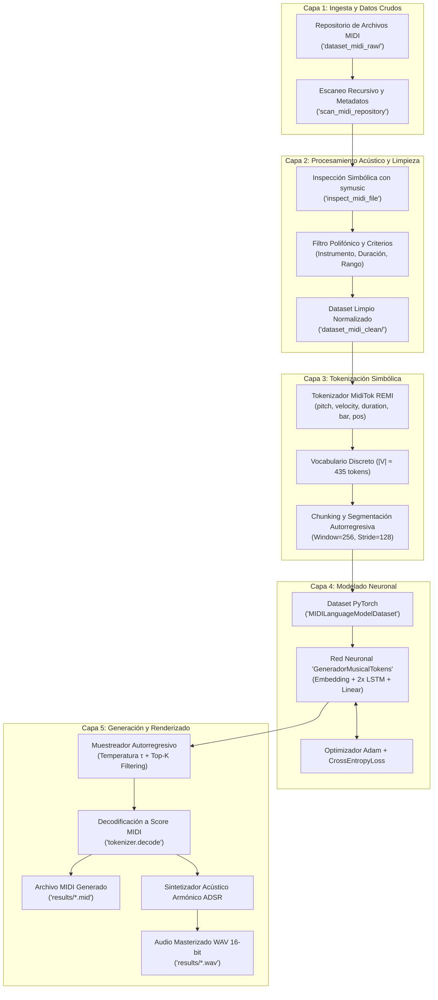
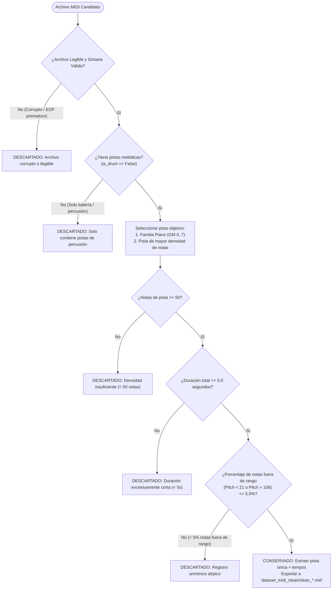
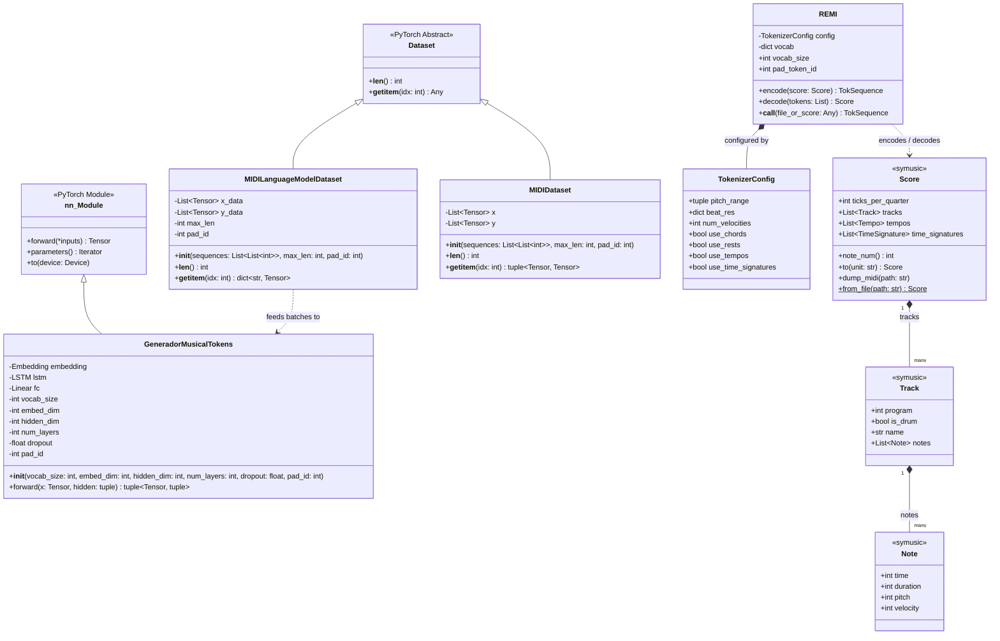
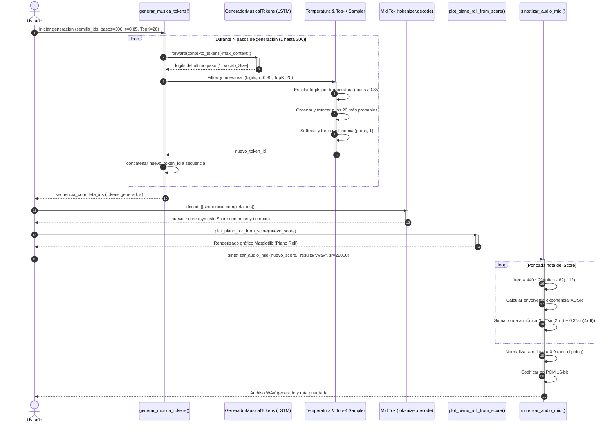
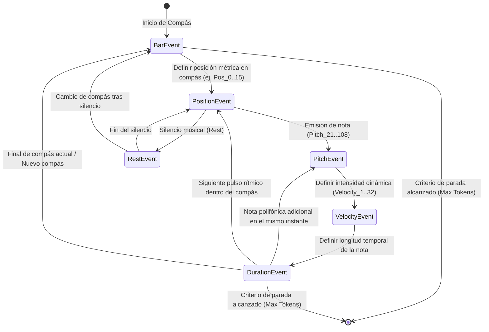

# 📊 Diagramas de Arquitectura, Flujo y Modelado UML

Este documento contiene la colección completa de especificaciones visuales y diagramas técnicos del **Proyecto MIDI**, modelados con sintaxis estándar de **Mermaid**.

---

## 📑 Índice de Diagramas
1. [Arquitectura General del Sistema](#1-arquitectura-general-del-sistema)
2. [Diagrama de Flujo del Pipeline Integral](#2-diagrama-de-flujo-del-pipeline-integral)
3. [Árbol de Decisión: Algoritmo de Limpieza y Filtrado](#3-árbol-de-decisión-algoritmo-de-limpieza-y-filtrado)
4. [Diagrama de Clases UML del Sistema](#4-diagrama-de-clases-uml-del-sistema)
5. [Diagrama de Secuencia: Inferencia Autorregresiva y Síntesis](#5-diagrama-de-secuencia-inferencia-autorregresiva-y-síntesis)
6. [Diagrama de Transición de Estados: Ciclo de Vida del Token Musical](#6-diagrama-de-transición-de-estados-ciclo-de-vida-del-token-musical)

---

## 1. Arquitectura General del Sistema

El sistema sigue una arquitectura modular en capas que desacopla la adquisición simbólica, la tokenización, el modelado neuronal de lenguaje musical y el motor de renderizado acústico.

---

## 2. Diagrama de Flujo del Pipeline Integral

Detalla la secuencia cronológica de transformación de datos desde la lectura de archivos brutos hasta la audición de la composición generada.

```mermaid
flowchart LR
    Start(["Inicio del Pipeline"]) --> Scan["1. Escanear Archivos MIDI<br>('dataset_midi_raw')"]
    Scan --> Inspect["2. Inspección Acústica<br>(symusic: notas, tracks, pitch)"]
    Inspect --> Filter{"3. ¿Supera Filtro de Calidad?<br>(>=50 notas, >=5s, 88 teclas)"}
    
    Filter -- "No" --> Discard["Registrar Descarte con Causa<br>(df_cleaning)"]
    Filter -- "Sí" --> Keep["Guardar MIDI Monotrack Limpio<br>('dataset_midi_clean')"]
    
    Keep --> Tokenize["4. Tokenización REMI<br>(MidiTok: Bar, Pos, Pitch, Vel)"]
    Tokenize --> Stats["5. Análisis Estadístico<br>(Histogramas, Min/Max/Promedio)"]
    Stats --> Chunk["6. Segmentación en Bloques<br>(Len: 256, Stride: 128)"]
    Chunk --> DataLoader["7. DataLoader PyTorch<br>(X = t_0..N-1, Y = t_1..N)"]
    
    DataLoader --> Train["8. Entrenamiento LSTM<br>(CrossEntropyLoss, Adam)"]
    Train --> Seed["9. Selección de Semilla<br>(Prompt de 16 tokens iniciales)"]
    
    Seed --> Generate["10. Generación Autorregresiva<br>(Temperature Scaling + Top-K)"]
    Generate --> Decode["11. Reconstrucción con tokenizer.decode<br>(Genera symusic.Score)"]
    
    Decode --> ExportMIDI["12. Exportar Archivo .mid<br>('results/composicion.mid')"]
    Decode --> Synthesize["13. Síntesis Aditiva ADSR<br>(Pure Python: f0 + 2f0)"]
    
    Synthesize --> ExportWAV["14. Guardar Audio WAV 16-bit<br>('results/composicion.wav')"]
    ExportMIDI --> Finish(["Fin del Proceso"])
    ExportWAV --> Finish
```

---

## 3. Árbol de Decisión: Algoritmo de Limpieza y Filtrado

Representa la lógica condicional exhaustiva ejecutada sobre cada archivo durante la fase de depuración de datos.

---

## 4. Diagrama de Clases UML del Sistema

Estructura de clases, componentes neuronales, datasets y adaptadores simbólicos.

---

## 5. Diagrama de Secuencia: Inferencia Autorregresiva y Síntesis

Detalla la interacción dinámica paso a paso entre el modelo de lenguaje, el muestreador con temperatura/Top-K, el decodificador MidiTok y el motor de síntesis de audio.

---

## 6. Diagrama de Transición de Estados: Ciclo de Vida del Token Musical

Ilustra las fases por las que transita un evento musical dentro de la representación REMI a lo largo del proceso generativo autorregresivo.

